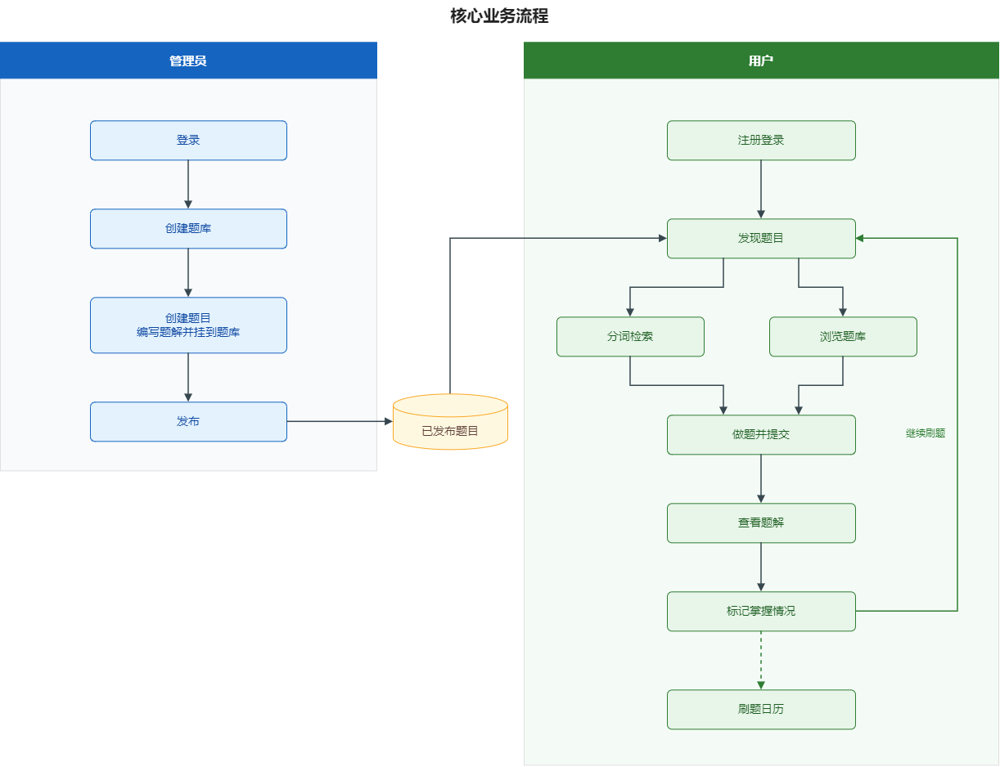
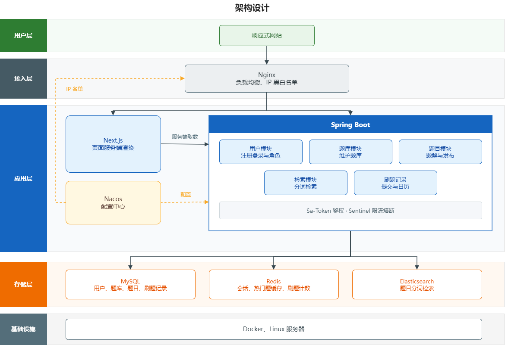

# 题津舟-智能面试刷题平台

## 功能

### 管理员端

- 创建题库
- 创建题目
- 创建题解

### 用户端

- 注册登录
- 分词检索题目
- 在线刷题
- 查看刷题记录日历图

## 项目三大阶段

1. 开发基础的刷题平台，实战Next.js服务端渲染 + SpringBoot应用的快速开发
2. 对项目功能进行扩展，精选4大真实场景，实战企业主流后端技术如Redis缓存和高级数据结构、Elasticsearch搜索引擎、Druid连接池、并发编程、热key探索的应用
3. 对项目安全性进行优化，比如基于Sentinel进行网站流量控制和熔断、基于Nacos实现动态的IP黑白名单、基于Sa-Token实现同端登录冲突检测、基于Redis实现分级反爬虫策略等。最终将项目上线并保证可用性。

## 项目功能梳理

### 基础模块（P0）

- 用户模块
  - 用户注册
  - 用户登录（账号、密码）
  - 【管理员】管理用户 - 增删改查
- 题库模块
  - 查看题库列表
  - 查看题库详情（展示题库下的题目）
  - 【管理员】管理题库 - 增删改查
- 题目模块
  - 题目搜索
  - 查看题目详情（进入刷题页面）
  - 【管理员】管理题目 - 增删改查（比如按照题库查询题目、修改题目所属题库等）

### 高级功能（P1-P2）

- 题目批量管理（P1）
  - 【管理员】批量向题库添加题目
  - 【管理员】批量从题库移除题目
  - 【管理员】批量删除题目
- 分词题目搜索（P1）
- 用户刷题记录日历图（P1）
- 自动缓存热门题目（P2）
- 网站流量控制和熔断（P2）
- 动态IP黑白名单过滤（P2）
- 同端登录冲突检测（P2）
- 分级题目反爬虫策略（P2）

## 技术选型

### 前端

- React 19 框架
- Next.js 服务端渲染
- Redux 状态管理
- Ant Design 组件库
- 富文本编辑器组件
- 前端工程化：ESLint + Prettier + TypeScript
- OpenAPI 前端代码生成

### 后端

- Java Spring Boot 框架 + Maven 多模块构建
- MySQL 数据库 + MyBatis-Plus 框架 + Mybatis X
- Redis 分布式缓存 + Caffeine 本地缓存
- Redission 分布式锁 + BitMap + BloomFilter
- Elasticsearch 搜索引擎
- Druid 数据库连接池 + 并发编程
- Sa-Token 权限控制
- HotKey 热点探测
- Sentinel 流量控制
- Nacos 配置中心
- 多角度项目优化：性能、安全性、可用性

## 核心业务流程

管理员使用已开通账号登录，创建题库和题目。题目在创建时编写题解并挂到题库，发布后进入已发布题目。用户注册登录后发现题目，分词检索和浏览题库是两条并行入口。提交作答后查看题解，再标记掌握情况，然后回到发现题目继续刷题。刷题日历读取这些标记。

## 架构设计

页面和接口分成两个进程。Nginx 把页面转给 Next.js，把接口转给 Spring Boot，Next.js 服务端渲染时再向 Spring Boot 取数。管理员和用户走同一套业务模块，在用户模块里用角色区分。Sa-Token 和 Sentinel 运行在 Spring Boot 进程内。Nacos 把业务配置推给 Spring Boot，把 IP 黑白名单推给 Nginx。热门题用 Redis 缓存和计数，不单独部署 HotKey 集群。

## 项目环境版本

后端以 Spring Boot 4.0.8 为基线。Spring Cloud Alibaba 2025.1 适配的是 4.0 线，不使用 Spring Boot 4.1。JDK 和 Node 装在本机，MySQL、Redis、Elasticsearch、Nacos、Nginx 用 Docker Compose 运行。

| 组件 | 版本 |
| --- | --- |
| JDK | 21（LTS） |
| Maven | 3.9 |
| Spring Boot | 4.0.8 |
| Spring Cloud | 2025.1.0 |
| Spring Cloud Alibaba | 2025.1.0.0 |
| Nacos Server | 3.1.1 |
| Sentinel | 1.8.9 |
| Sa-Token | 1.45.0，使用 `sa-token-spring-boot4-starter` |
| MyBatis-Plus | 3.5.17，使用 `mybatis-plus-spring-boot4-starter` |
| Redisson | 4.x，Spring Data 模块使用 `redisson-spring-data-40` |
| Druid | 1.2，使用 Spring Boot 4 对应的 starter |
| MySQL | 8.4（LTS） |
| Redis | 8 |
| Elasticsearch | 9.1 |
| Node.js | 24（LTS） |
| Next.js | 16.4 |
| React | 19 |
| Ant Design | 6，图标使用 `@ant-design/icons` 6 |
| TypeScript | 跟随 Next.js 脚手架自带版本 |
| Nginx | 1.28 |
| Docker Compose | v2 |
