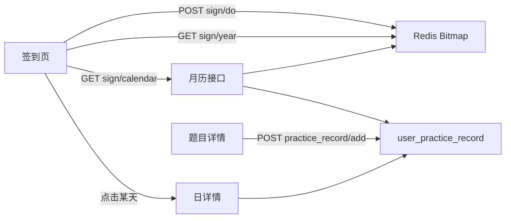
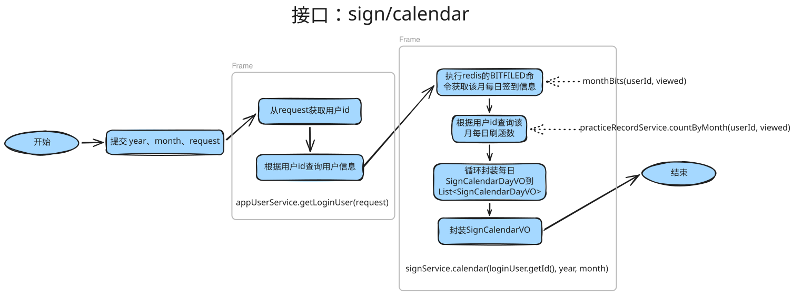
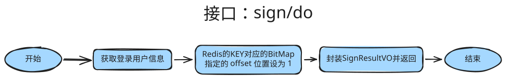
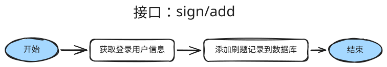

# 用户签到记录日历

## 方案设计

签到和刷题分开存。每天手动签到写入 Redis Bitmap。打开题目详情写入 MySQL 刷题流水。月历同时展示这两类数据。

本文只定方案。实现时再改 SQL、后端和前端代码。

### 功能边界

- 签到：登录用户每天手动点一次。同一天重复点击仍返回成功，不记第二次。
- 刷题：登录用户打开题目详情记一次。同一用户、同一题、同一天只保留一行。当前没有作答和掌握接口，打开详情就是「刷过」。以后改成提交或标记掌握时，只换写入时机，日历接口不变。
- 日历只看当前登录用户，不提供查看他人记录。
- 日期按服务器本地时区的自然日切分，默认 `Asia/Shanghai`。月、日、连续天数都用这个时区，不用 UTC 的日期。

### 签到：Redis Bitmap

签到不建表。一个用户一个月一个 Bitmap。

- Key：`sign:{userId}:{yyyyMM}`，例如 `sign:123:202610`
- 偏移：当月第几天减 1，范围 0–30。10 月 1 日是 0，10 月 17 日是 16
- 位值：`1` 表示已签到
- 不设过期。一个用户一个月最多 31 bit

读写：

- 签到用 `SETBIT`。它是原子操作，返回该位的旧值。旧值为 `1` 表示今天已经签过，接口仍成功，`alreadySigned = true`。不用分布式锁。（分布式锁的作用：保证不同服务实例/进程/线程对共享资源的互斥访问）
- 查整月用 `BITFIELD key GET u{当月天数} 0`。2 月只有 28 或 29 天，未使用的高位保持 0，按当月天数解析即可。
- 本月签到天数用 `BITCOUNT`。
- 连续签到从今天往前数。今天未签则从昨天往前数。跨月时读上一个月的 key。今天和昨天都未签则为 0。

Bitmap 读写放在 `SignService`，使用 `StringRedisTemplate`。

### 刷题记录表

表名 `user_practice_record`。这是流水，不做逻辑删除。题目删除后，当天题数仍按流水行计算。日详情里题目已删除或不存在时，标题显示「题目已删除」。

```mysql
create table if not exists user_practice_record
(
    id            bigint   not null auto_increment comment 'id',
    user_id       bigint   not null comment '用户 id',
    question_id   bigint   not null comment '题目 id',
    practice_date date     not null comment '刷题日期，按 Asia/Shanghai 自然日',
    create_time   datetime not null default current_timestamp comment '创建时间',
    primary key (id),
    unique key uk_user_question_date (user_id, question_id, practice_date),
    index idx_user_date (user_id, practice_date)
) engine = InnoDB
  default charset = utf8mb4
  collate = utf8mb4_0900_ai_ci
  comment = '用户刷题记录';
```

唯一键冲突视为成功，不向前端报错。

### 后端接口

控制器前缀挂在现有 `context-path: /api` 下。登录用户用 `AppUserService.getLoginUser`，未登录走现有 `40100`。响应包 `BaseResponse`，`code = 0` 为成功。对外字段用 camelCase。

#### POST /api/sign/do

无请求体。

```json
{
  "code": 0,
  "data": {
    "signed": true,
    "alreadySigned": false,
    "signDate": "2026-10-17",
    "monthSignCount": 5,
    "streak": 3
  },
  "message": "ok"
}
```

- `signed`：本次调用结束后今天是否已签到，成功时恒为 `true`
- `alreadySigned`：调用前今天是否已经签过
- `signDate`：今天的日期
- `monthSignCount`：本月已签到天数，含今天
- `streak`：连续签到天数

#### GET /api/sign/calendar

查询参数 `year`、`month`。缺省或非法时返回参数错误。`month` 取值 1–12。

返回当月每一天，不只返回有数据的日期。签到位来自 Bitmap，`practiceCount` 来自 `user_practice_record` 按 `practice_date` 计数。

```json
{
  "code": 0,
  "data": {
    "year": 2026,
    "month": 10,
    "today": "2026-10-17",
    "signedToday": true,
    "monthSignCount": 5,
    "streak": 3,
    "days": [
      { "date": "2026-10-01", "signed": true, "practiceCount": 2 },
      { "date": "2026-10-02", "signed": false, "practiceCount": 0 }
    ]
  },
  "message": "ok"
}
```

`days` 长度等于该月天数，按日期升序。`signedToday`、`monthSignCount`、`streak` 相对「今天」计算，与正在查看的月份无关。查看历史月份时，这三个字段仍描述当前签到状态。

#### GET /api/sign/year

查询参数 `year`。缺省或不在 1–9999 时返回参数错误。

只读 Redis Bitmap，不查刷题表。对 1 月到 12 月各做一次 `BITFIELD`。返回该年每一天，以及 `Asia/Shanghai` 的 `today`。

```json
{
  "code": 0,
  "data": {
    "year": 2026,
    "today": "2026-10-19",
    "days": [
      { "date": "2026-01-01", "signed": false },
      { "date": "2026-01-02", "signed": true }
    ]
  },
  "message": "ok"
}
```

`days` 长度为 365 或 366，按日期升序。只有 `date` 和 `signed`。

#### GET /api/sign/day

查询参数 `date`，格式 `yyyy-MM-dd`。

```json
{
  "code": 0,
  "data": {
    "date": "2026-10-17",
    "signed": true,
    "questions": [
      { "id": "1001", "title": "两数之和" }
    ]
  },
  "message": "ok"
}
```

`id` 用字符串，与现有 Long 序列化一致。题目已删除或不存在时保留这条记录，`title` 为「题目已删除」。当天没有刷题时 `questions` 为空数组。

#### POST /api/practice_record/add

```json
{
  "questionId": "1001"
}
```

题目必须存在且未删除，否则参数错误。同一用户、同一题、同一天重复提交返回成功。响应 `data` 为 `true`。

### 代码落点

沿用现有分层。实体字段保持数据库列的 snake_case。VO 手写转换，不用 BeanUtils 对 snake_case 实体做拷贝。

- `controller/SignController.java`：`@RequestMapping("/sign")`，提供 `/do`、`/calendar`、`/year`、`/day`
- `controller/PracticeRecordController.java`：`@RequestMapping("/practice_record")`，提供 `/add`
- `service/SignService.java`：Bitmap 的签到、整月读取、本月计数、连续天数
- `model/entity/UserPracticeRecord.java`：字段 `user_id`、`question_id`、`practice_date`、`create_time`
- `mapper/UserPracticeRecordMapper.java`：继承 `BaseMapper`
- `model/dto/practicerecord/PracticeRecordAddRequest.java`：`questionId`
- `model/vo/SignResultVO.java`、`SignCalendarVO.java`、`SignYearVO.java`、`SignDayVO.java`

月历查询在服务层合并 Bitmap 与按日计数，控制器只做登录校验和参数校验。

### Redis 与登录态

当前 `MainApplication` 排除了 `DataRedisAutoConfiguration`，`application.yml` 里的 Redis 配置处于注释状态。实现签到时打开 Redis 连接，供 `StringRedisTemplate` 使用。

`pom.xml` 已引入 `spring-boot-starter-session-data-redis`。Redis 一旦可用，Spring Session 可能把登录态从容器 Session 切到 Redis。签到使用 Redis 时，登录态继续留在容器 Session，本次不改登录方案。实现时需要排除 Spring Session 的自动配置，或者不启用该 starter，避免签到上线改变现有登录行为。

### 前端方案

#### 页面

新页面 `tijinzhou-frontend/src/app/user/sign/page.tsx`，`"use client"`。未登录沿用 `src/libs/request.ts` 里 `code === 40100` 跳转 `/user/login` 的行为。

`BasicLayout` 在已登录时增加导航「签到」，指向 `/user/sign`。未登录不显示这个入口。

页面结构：

- 顶栏：今日签到按钮、连续天数、本月签到天数。`signedToday` 为真时按钮禁用，文案为「已签到」。点击调用 `POST /api/sign/do`，成功后同时刷新当前月历和年热力图。
- 年热力图放在月历上方，组件 `src/components/SignYearHeatmap.tsx`。一周从周日排起，一列是一周。只区分已签到（绿色）和未签到（浅灰），还没到来的日期也用浅灰。悬停显示日期和状态。点击某一天，月历切到该月并打开当天抽屉。可切换年份，默认年份取月历接口里的 `today`。格子过宽时横向滚动。
- Ant Design `Calendar`：`onPanelChange` 用新的 `year`、`month` 重新请求月历。单元格里，`signed` 为真时显示绿色「已签」；`practiceCount > 0` 时显示「刷 n 题」。两项可以同时出现。
- 点击某一天打开 `Drawer`，请求 `GET /api/sign/day`。列出题目标题，链到 `/question/{id}`。标题为「题目已删除」的项不提供跳转。

#### 请求封装

- `src/api/sign.ts`：`signIn`、`getSignCalendar`、`getSignYear`、`getSignDay`
- `src/api/practiceRecord.ts`：`addPracticeRecord`
- 类型加在 `src/types/api.ts`：`SignResult`、`SignCalendar`、`SignYear`、`SignDay`、`SignDayItem`

调用方式与 `src/api/user.ts` 相同，走 `post` / `get`，`withCredentials: true`。#### 题目详情记刷题

`src/app/question/[id]/page.tsx` 在题目加载成功，且 Redux 中存在 `loginUser` 时，调用 `addPracticeRecord({ questionId })`。失败只记录日志，不弹出错误，不打断阅读。未登录不调用。

### 数据流



## 初步实现

### 数据库设计

#### 数据库创建

```mysql
-- 用户刷题记录表
create table if not exists user_practice_record
(
    id            bigint   not null auto_increment comment 'id',
    user_id       bigint   not null comment '用户 id',
    question_id   bigint   not null comment '题目 id',
    practice_date date     not null comment '刷题日期，按 Asia/Shanghai 自然日',
    create_time   datetime not null default current_timestamp comment '创建时间',
    primary key (id),
    unique key uk_user_question_date (user_id, question_id, practice_date),
    index idx_user_date (user_id, practice_date)
) engine = InnoDB
  default charset = utf8mb4
  collate = utf8mb4_0900_ai_ci
  comment = '用户刷题记录';
```

#### 实体类

```java
@TableName(value = "user_practice_record")
@Data
public class UserPracticeRecord {

    /**
     * id
     */
    @TableId(type = IdType.ASSIGN_ID)
    private Long id;

    /**
     * 用户 id
     */
    private Long user_id;

    /**
     * 题目 id
     */
    private Long question_id;

    /**
     * 刷题日期，按 Asia/Shanghai 自然日
     */
    private LocalDate practice_date;

    /**
     * 创建时间
     */
    private Date create_time;
}
```

### 值对象`vo`(value object)：

#### `SignCalendarDayVO`

（月历中的一天）：

```java
@Data
public class SignCalendarDayVO implements Serializable {

    /**
     * 日期
     */
    private String date;

    /**
     * 是否签到
     */
    private Boolean signed;

    /**
     * 当天刷题数
     */
    private Integer practiceCount;

    private static final long serialVersionUID = 1L;
}
```

#### `SignCalendarVO`

（签到月历）：

```java
@Data
public class SignCalendarVO implements Serializable {

    /**
     * 年
     */
    private Integer year;

    /**
     * 月，1-12
     */
    private Integer month;

    /**
     * 今天
     */
    private String today;

    /**
     * 今天是否已签到
     */
    private Boolean signedToday;

    /**
     * 本月已签到天数，相对今天所在月
     */
    private Integer monthSignCount;

    /**
     * 连续签到天数
     */
    private Integer streak;

    /**
     * 当月每一天
     */
    private List<SignCalendarDayVO> days;

    private static final long serialVersionUID = 1L;
}
```

#### `SignDayQuestionVO`

（某天刷过的题目）：

```java
@Data
public class SignDayQuestionVO implements Serializable {

    /**
     * 题目 id
     */
    private Long id;

    /**
     * 题目标题。题目已删除时为「题目已删除」
     */
    private String title;

    private static final long serialVersionUID = 1L;
}

```

#### `SignDayVO`

（某一天的签到和刷题）:

```java
@Data
public class SignDayVO implements Serializable {

    /**
     * 日期
     */
    private String date;

    /**
     * 是否签到
     */
    private Boolean signed;

    /**
     * 当天题目，按刷题时间升序
     */
    private List<SignDayQuestionVO> questions;

    private static final long serialVersionUID = 1L;
}

```

#### `SignResultVO`

（签到结果）：

```java
@Data
public class SignResultVO implements Serializable {

    /**
     * 调用结束后今天是否已签到
     */
    private Boolean signed;

    /**
     * 调用前今天是否已经签过
     */
    private Boolean alreadySigned;

    /**
     * 今天的日期
     */
    private String signDate;

    /**
     * 本月已签到天数，含今天
     */
    private Integer monthSignCount;

    /**
     * 连续签到天数
     */
    private Integer streak;

    private static final long serialVersionUID = 1L;
}
```

### 

```java
@RestController
@RequestMapping("/practice_record")
public class PracticeRecordController {

    @Resource
    private PracticeRecordService practiceRecordServ

    @Resource
    private AppUserService appUserService;

    @PostMapping("/add")
    public BaseResponse<Boolean> add(@RequestBody PracticeRecordAddRequest practiceRecordAddRequest,
            HttpServletRequest request) {
        // 请求判断
        if (practiceRecordAddRequest == null || practiceRecordAddRequest.getQuestionId() == null) {
            throw new BusinessException(ErrorCode.PARAMS_ERROR);
        }
        // 获取登录用户信息
        AppUser loginUser = appUserService.getLoginUser(request);
        // 添加刷题记录
        return ResultUtils.success(practiceRecordService.addRecord(loginUser.getId(),
                practiceRecordAddRequest.getQuestionId()));
    }
}
```

### 接口实现

#### sign/calendar

##### 流程图



##### 亮点

- 签到记录用`Redis BitMap`，不建表。每个用户每月一个`KEY`，每天只占用一个`bit`。

#### sign/do

##### 流程图



##### 亮点

- 签到用`redis`存，不存数据库
- 签到时直接把对应的`BitMap`用`setbit`就行，而且由于`Redis单线程`+`setBit原子性`，保证了并发的安全性，所以不用加分布式锁

#### sign/add

##### 流程图



## 存在问题

##### 签到数据只存在Redis

数据卷丢失、执行 `FLUSHDB`，或者换一个 `Redis` 实例，连续签到天数和历史签到记录就全没了，`mysqldump` 也备份不到这部分数据。

##### 登录态没共享

当前登录态仍依赖本机 `JSESSIONID`，没有进 `Redis` 等共享存储。现在单实例能跑，一旦部署多台 `Tomcat`，用户请求打到另一台就认不出登录状态，会话无法共享。

##### 刷过的逻辑太简单

现在“打开题目”=“刷过题目”，后期需要把逻辑改一下，比如提交答案并且AI判题正确才算刷过。

##### 月历和连续天数是会随使用变重的热点。

为了计算月刷题数需要从 `mysql` 把该月流水全部查出来，然后在内存里计数

连续天数如果跨月，需要再发 `BITFIELD`，如果跨的月数过多，可能查询的速度会变慢


